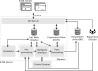

ICON is structured as a modular backend-frontend system.

{ width="100%" }

The backend server runs as multiple processes, each with a clear responsibility:

* **API Server**

    The main process. It exposes API endpoints ("controllers") via `pydase`. All communication between clients and the backend goes through this server.

    * Provides experiment and parameter metadata from the experiment library.
    * Allows parameter values in InfluxDB to be read and updated.
    * Provides access to data from running and past jobs.
    * Accepts new jobs, storing them in the SQLite job table.

* **Scheduler**

    Retrieves jobs from the SQLite database and dispatches them to workers. Jobs are assigned a priority, then pushed into a priority queue consumed by the pre-processing workers.

* **Pre-Processing Workers**

    One or more workers that prepare jobs before execution. For each job, they:

    * Fetch the relevant parameters from InfluxDB.
    * Generate JSON sequences for each data point using the experiment library.
    * Place the prepared data points into their own task queue, in order, keeping at most `server.pre_processing.queue_size` of them queued.
    * Take queued data points back out of their task queue when the job's parameters change (they are prepared again with the new parameters), and hold them while the job is paused.

    The **arbiter** pulls the hardware worker's next data point out of the workers' task queues once it is ready to run it, or waits for one to be queued if they are all empty or held. The arbiter and the task queues live in the shared resource manager's process. Data points of jobs with a lower priority value go first, then the ones prepared first. Only jobs that a pre-processing worker has picked up take part.

* **Hardware Worker**

    A single worker that interfaces with the control hardware and external devices. For each data point:

    * Takes the next data point from the arbiter, and tells the arbiter once it is done.
    * Ensures device parameters are set if they are part of the scan.
    * Executes the JSON sequence on the control hardware.
    * Places the raw results into the queue for post-processing.

* **Post-Processing Worker**

    Currently a single worker (but can be scaled out). It:

    * Processes raw results.
    * Stores experiment data into HDF5 files.
    * Updates parameter values in InfluxDB when appropriate (e.g. calibrations - not yet implemented).

**Clients** connect to the API server via Socket.IO and provide user interfaces:

* **Web browser client (React/TypeScript)** - the main interface for scheduling experiments, configuring parameters, visualising live and past data, and controlling devices.
* **Python client** - intended for scripting and automation (work in progress).
